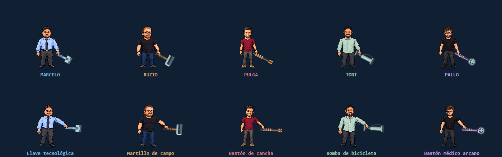

# Armas de cuerpo a cuerpo

Versión 0.6. Las armas se usan con **Z** o con el botón táctil **ARMA**. Mantener el botón repite el ataque. Cada arma permanece en la mano al caminar y saltar.

| Amigo | Arma | Diseño |
|---|---|---|
| Marcelo | Llave tecnológica | Llave metálica con mango azul y un indicador luminoso. |
| Ruzio | Martillo de campo | Mango de madera y cabeza de acero; es más corto que el martillo de su definitiva. |
| Pulga | Bastón de cancha | Bastón de entrenamiento con agarre envuelto y extremo naranja inspirado en el balón. |
| Tobi | Bomba de bicicleta | Bomba metálica con manilla y manguera, usada como porra. |
| Pallo | Bastón médico arcano | Bastón violeta con emblema médico verde; el golpe básico es físico. |

Todos los ataques básicos mantienen **10 de daño**, no gastan energía y conservan un tiempo de ejecución de 0,30 s con una separación mínima de 0,32 s entre ataques. Las definitivas conservan sus efectos propios y su costo de 100 de energía. El golpe básico de Pallo no cura.

La herramienta comparte la transformación de la mano. La palma se dibuja sobre el mango usando sus píxeles originales. El daño se comprueba contra el barrido de la herramienta, dentro de la ventana activa del ataque, y un mismo objetivo recibe como máximo un impacto por ejecución.

La longitud y el grosor de las herramientas varían. Su alcance corresponde al cuerpo y al objeto dibujados, en lugar de usar el rectángulo del puñetazo anterior. Esto conserva el daño por golpe, aunque el espacio útil del ataque cambia ligeramente.

[Ver las armas en movimiento](animaciones.html?accion=arma). El visor permite pausar, avanzar cuadro a cuadro y cambiar de sentido. El personaje usa su arma básica en reposo, marcha y salto; al seleccionar «Definitiva» muestra la secuencia de su poder.

## Verificación

- Los cinco amigos golpean hacia ambos lados, con un solo impacto de 10 de daño por ataque.
- No se alcanza al objetivo de detrás ni al que está fuera del alcance.
- La mano y el mango comparten su posición; la geometría de daño coincide con la herramienta dibujada en reposo, marcha y salto.
- El ataque funciona sin energía; la definitiva conserva su costo.
- La campaña de rescates y jefes se comprueba con cada personaje.
- Se mantiene una prueba separada de las definitivas y la adaptación móvil.

La animación continúa partiendo de los sprites frontales y recortes articulados. No reemplaza un pase de dibujo de manos y poses exclusivas en pixel art.
